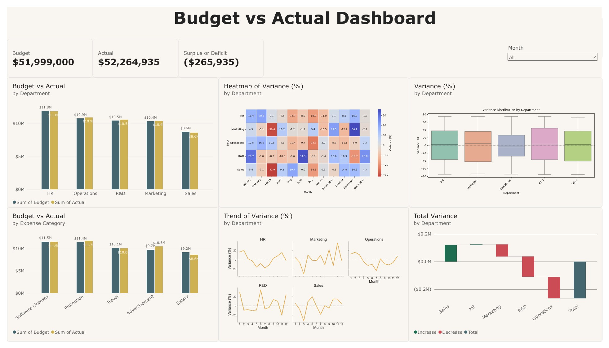
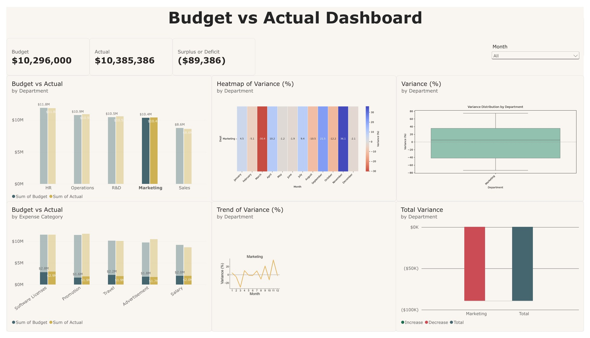
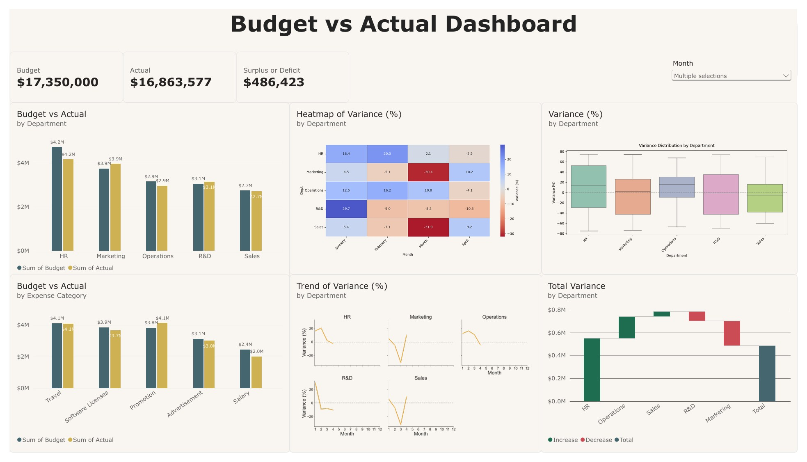

# Financial Dashboard Showcase

Visualizing departmental budget vs. actual performance using Power BI and FP&A methods.

  ---

## Sample Visuals

| Full Executive Dashboard |
|--------|
|  |

| Drill-down View: Single Department |
|--------|
|  |

| Date Filtered View: First 4 Months |
|--------|
|  |

---

## What’s Inside

| # | File | Description | Download |
|--------|------|-------------|:----:|
| **1** | `variance_analysis.csv` | Synthetic datasets generated by Python for case study |
| **2** | `variance_analysis.pbix` | Interactive Power BI dashboard file | [Download](./variance_analysis.pbix) |
| **3** | `variance_analysis_dashboard.pdf` | Full executive dashboard including bar, heatmap, box plot, and waterfall charts |
| **4** | `variance_analysis_drill_down_to_single_department.pdf` | Dashboard view filtered by single department drill-down |
| **5** | `variance_analysis_multiselect_first_four_months.pdf` | Dashboard view filtered by the first 4 months |

---

## Tools Used

- Power BI
- Python
- Pandas
- Numpy
- Matplotlib
- Seaborn
